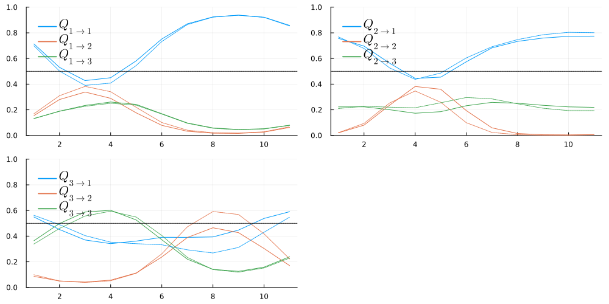
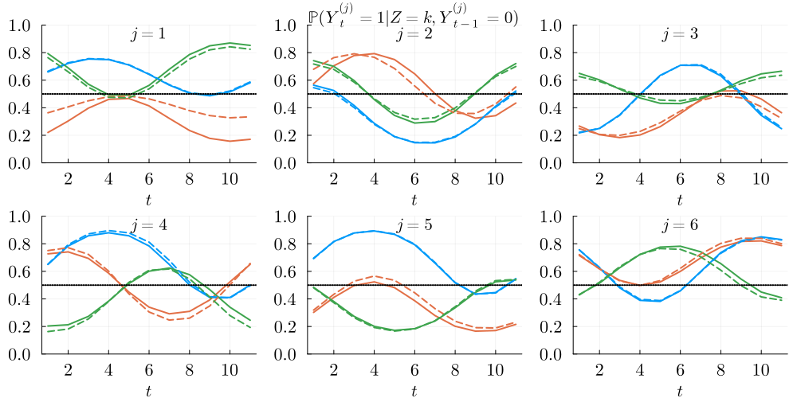
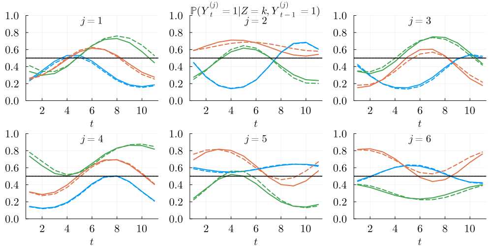

# SmoothPeriodicStatsModels

[](https://github.com/dmetivie/SmoothPeriodicStatsModels.jl/actions/workflows/CI.yml?query=branch%3Amaster)

This package is primarily built to be an extension of the [StochasticWeatherGenerators](https://github.com/dmetivie/StochasticWeatherGenerators.jl) package. See the [tutorial](https://dmetivie.github.io/StochasticWeatherGenerators.jl/dev/examples/tuto_paper/) for an example of usage.

It builds several smooth versions of statistical models for time series, currently including:

- AR(1) Auto-Regressive model of order 1
- Mixture Models
- Auto-Regressive Periodic Hidden Markov Model. For now, it only has Bernoulli mixture emission distributions, i.e., conditionally independent distributions.

**Smooth** means that temporal coefficients of the models e.g., $p(t)\in [0,1]$ for Bernoulli parameter and $t\in [1,T]$ have a periodic functional form to enforce smoothness i.e., $p(t)\simeq p(t+1)$.
Note that the package [PeriodicHiddenMarkovModels.jl](https://github.com/dmetivie/PeriodicHiddenMarkovModels.jl) also deals with Periodic HMM, but right now, it does not enforce smoothness; hence if you don't have many observations, you can have $p(t)$ very different from $p(t+1)$. Moreover, this causes identifiability issues of the hidden states.

The HMM part of this package could be moved at some point to [PeriodicHiddenMarkovModels.jl](https://github.com/dmetivie/PeriodicHiddenMarkovModels.jl), making use under the hood of the very nice and flexible [HiddenMarkovModels.jl](https://github.com/gdalle/HiddenMarkovModels.jl) package.

This is inspired by seasonal Hidden Markov Models; see [A. Touron (2019)](https://link.springer.com/article/10.1007/s11222-019-09854-4) and used in the paper [Interpretable Seasonal Multisite Hidden Markov Model for stochastic rain generation in France](https://hal.inrae.fr/hal-04621349).

## Example

This example shows how to use the `ARPeriodicHMM` model, which is a periodic HMM with multivariate Bernoulli emission distributions of dimension $D=6$ and autoregressive dependence on past observations. This model assumes conditional independence, i.e., given the hidden states and the past observations, the multivariate Bernoulli distribution is independent (conditional independence),

```math
\mathbb{P}(Y_n = y_t \mid Z_n = k, Y_{n-1} = y_{n-1}) = \prod_{j=1}^D \mathbb{P}\left(Y_{n}^{(j)} = y_{n}^{(j)}\mid  Z_n = k, Y_{n-1}^{(j)} = y_{n-1}^{(j)}\right).
```

Under the hood, to deal with arbitrary autoregressive orders, the past observations are encoded in a variable $H$ of dimension $D \times (2^p)$, where $p$ is the autoregressive order (see the [paper](https://hal.inrae.fr/hal-04621349) for a more precise definition).

### Set up

```julia
using SmoothPeriodicStatsModels
using Random
```

```julia
Random.seed!(2020)
K = 3 # Number of hidden states
T = 11 # Period
N = 49_586 # Length of observation
D = 6 # Dimension of observed variables
autoregressive_order = 1

size_order = 2^autoregressive_order
degree_of_P = 1
size_degree_of_P = 2*degree_of_P + 1 

trans_θ = 4*(rand(K, K - 1, size_degree_of_P) .- 1/2)
Bernoulli_θ = 2*(rand(K, D, size_order, size_degree_of_P) .- 1/2)
hmm = Trig2ARPeriodicHMM([1/3, 1/6, 1/2], trans_θ, Bernoulli_θ, T)
```

### Simulations

Multivariate observations are `dimension × sample`, the convention of `Distributions.jl`: `y[j, n]`
is site `j` at time `n`, and the initial condition `y_past[j, m]` is site `j` at `m` steps before
the first observation. The same holds for `Y`, `Y_past` and `lag_cat` everywhere in the package.

```julia
z_ini = 1
y_past = rand(Bool, D, autoregressive_order)
n2t = SmoothPeriodicStatsModels.n_to_t(N,T)
z, y = rand(hmm, n2t; y_ini=y_past, z_ini=z_ini, seq=true)
```

### Fit

Fitting lives in a package extension, so the solver stack has to be loaded. Any
[Optimization.jl](https://docs.sciml.ai/Optimization/stable/) algorithm will then do; this picks
`LBFGS` from `OptimizationOptimJL`, which is also the default.

```julia
using Optimization, OptimizationOptimJL, SimpleNonlinearSolve, ForwardDiff

trans_θ_guess = rand(K, K-1, size_degree_of_P)
Bernoulli_θ_guess = zeros(K, D, size_order, size_degree_of_P)
trans_θ_guess[:,:,1] .= trans_θ[:,:,1] # cheating on initial guess to recover very good MLE maxima
Bernoulli_θ_guess[:,:,:,1] = Bernoulli_θ[:,:,:,1]
hmm_guess = Trig2ARPeriodicHMM([1/4, 1/4, 1/2], trans_θ_guess, Bernoulli_θ_guess, T)

@time "FitMLE SHMM (Baum Welch)" hmm_fit, θq_fit, θy_fit, hist, histo_A, histo_B = fit_mle(hmm_guess, trans_θ_guess, Bernoulli_θ_guess, y, y_past, maxiter=10000, robust=true; display=:iter, tol=1e-3, θ_iters=true, n2t=n2t);
# EM converged in 317 iterations, logtot = -194299.41771034154
# FitMLE SHMM (Baum Welch): 8.808367 seconds (7.63 M allocations: 798.943 MiB, 3.00% gc time)
```

Every `fit_mle` takes the solver as a keyword, so any algorithm of the
[Optimization.jl](https://docs.sciml.ai/Optimization/stable/) ecosystem can be used, and the
independent sub-problems of each M-step can be run in parallel:

```julia
using OptimizationOptimJL
fit_mle(hmm_guess, trans_θ_guess, Bernoulli_θ_guess, y, y_past; n2t=n2t,
        solver = LBFGS(),                    # any Optimization.jl solver; this is the default
        ensemble = EnsembleThreads(),        # EnsembleSerial (default) / EnsembleThreads / EnsembleDistributed
        solve_kwargs = (maxiters = 100,))    # forwarded verbatim to `solve`
```

### The seasonal mixture

The EM loop for the seasonal mixture is
[ExpectationMaximization.jl](https://github.com/dmetivie/ExpectationMaximization.jl)'s. Only the
*parametrization* here is periodic, so this package supplies that — the weights and components as
trigonometric polynomials — and hands the iteration over. Concretely, `SeasonalWeights`,
`SeasonalFamily` and `SeasonalSample` carry the parametrization, and the `loglikelihoods!` and
`M_step!` methods they dispatch are the seasonal E- and M-steps. Nothing in that package needed
changing.

A consequence worth knowing: its keywords work here too. `rtol` alongside `tol`,
`method = StochasticEM(rng)` for stochastic EM, and a vector of per-observation weights passed
positionally after `n2t`.

### Adding your own seasonal family

The seasonal mixture EM is not tied to `Exponential`. `fit_mle` dispatches the component M-step on
the distribution type, so a new family is **one method of `update_dist`** — defined from outside
the package, with no change to it.

Such a method owns the four things that genuinely vary between families: which sufficient
statistics to aggregate per period index, how `theta_Y` lays out the coefficients, the negative
loglikelihood (any plain `(theta, p) -> Number`), and the link mapping the trigonometric
polynomial back onto the parameter domain.

Here is a seasonal `Rayleigh`, scale `S(t) = exp(P(t))`, in full:

```julia
using SmoothPeriodicStatsModels, Distributions
using Optimization, OptimizationOptimJL, SimpleNonlinearSolve, ForwardDiff
const SPSM = SmoothPeriodicStatsModels

# logpdf = log(y) - 2log(S) - y^2 / (2S^2), weighted by the posteriors and summed per period
function rayleigh_nll(theta, (s_pi, s_piy2, basis))
    P = basis * theta
    nll = zero(eltype(P))
    for t in eachindex(P)
        nll += 2 * s_pi[t] * P[t] + s_piy2[t] * exp(-2P[t]) / 2
    end
    return nll
end

function SPSM.update_dist(dist::AbstractVector{<:Rayleigh}, theta_Y, gamma, obs, n_in_t, basis;
        solver = default_solver(), adtype = default_adtype(), solve_kwargs = (;))
    T = length(dist)
    theta_Y = copy(theta_Y)
    s_pi   = [sum(gamma[n]              for n in n_in_t[t]; init = 0.0) for t = 1:T]
    s_piy2 = [sum(gamma[n] * obs[n]^2   for n in n_in_t[t]; init = 0.0) for t = 1:T]

    theta_Y[:] = solve_unconstrained(rayleigh_nll, collect(theta_Y[:]), (s_pi, s_piy2, basis);
        solver, adtype, solve_kwargs)

    return Rayleigh.([exp(polynomial_trigo(t / T, theta_Y[:])) for t = 1:T]), theta_Y
end
```

That is the whole addition -- `fit_mle` is then used exactly as with `Exponential`:

```julia
T, N = 20, 4000
n2t = repeat(1:T, N ÷ T)
theta_true = hcat([0.3, 0.4, -0.2], [1.6, -0.3, 0.5], [0.1, -0.5, 1.0])
mix(t, th) = MixtureModel([Rayleigh(exp(polynomial_trigo(t, th[:, 1]))),
                           Rayleigh(exp(polynomial_trigo(t, th[:, 2])))],
                          [αₜ(t, th[:, 3]), 1 - αₜ(t, th[:, 3])])
y = [rand(mix(t / T, theta_true)) for t in n2t]

theta0 = hcat([0.0, 0.0, 0.0], [1.0, 0.0, 0.0], [0.0, 0.2, 0.0])
mix_fit, theta_a, theta_Y, history = fit_mle([mix(t / T, theta0) for t = 1:T],
    permutedims(theta0[:, 3]), [theta0[:, 1], theta0[:, 2]], y, n2t; maxiter = 200, tol = 1e-5)

# A typical run (the draws above are unseeded, so the digits move a little):
# EM converged in 101 iterations, loglikelihood -8386.55 -> -8165.31
# theta_Y[1] = [0.338, 0.435, -0.235]   (true [0.3, 0.4, -0.2])
# theta_Y[2] = [1.588, -0.288, 0.495]   (true [1.6, -0.3, 0.5])
```

Note that the emission of `ARPeriodicHMM` is *not yet* pluggable this way: the binary memory encoding
(`conditional_to`, `bin2digit`, the `2^order` axis of `B`) makes the Bernoulli family structural
there rather than a choice.

### Plots

<details close>

<summary>Code for the plot</summary>

```julia
using LaTeXStrings, Plots
using Distributions: succprob

default(fontfamily="Computer Modern", linewidth=2, label=nothing, grid=true, framestyle=:default, legendfontsize=14, foreground_color_legend=nothing, background_color_legend=nothing, tickfontsize=14, xlabelfontsize=14, ylabelfontsize=14)
```

```julia
begin
    pA = [plot() for k in 1:K]
    for k in 1:K
        [plot!(pA[k], hmm.A[k, l, :], c=l, label=L"Q_{%$(k)\to %$(l)}", legend=:topleft) for l in 1:K]
        [plot!(pA[k], hmm_fit.A[k, l, :], c=l, label=:none, legend=:topleft, s = :dash) for l in 1:K]

        hline!(pA[k], [0.5], c=:black, label=:none, s=:dot)
        ylims!(0,1)
        xlabel!(pA[k], L"t")
    end
    pallA = plot(pA..., size=(1000, 500), bottom_margin=3Plots.mm)
end
```

```julia
begin
    mm = 1 # H = 1  <=> {Y_{t-1} = 0}
    pB = [plot() for j in 1:D]
    for j in 1:D
        [plot!(pB[j], succprob.(hmm.B[k, :, j, mm]), c=k, label=:none) for k in 1:K]
        [plot!(pB[j], succprob.(hmm_fit.B[k, :, j, mm]), c=k, label=:none, s = :dash) for k in 1:K]

        hline!(pB[j], [0.5], c=:black, label=:none, s=:dot)
        ylims!(pB[j], (0, 1))
        xlabel!(pB[j], L"t")
        annotate!(pB[j], (0.5, 0.93), L"j=%$(j)")
        j==2 ? title!(pB[j], L"\mathbb{P}(Y_t^{(j)}=1|Z=k, Y_{t-1}^{(j)} = 0)") : nothing
    end
    pallB = plot(pB..., size=(1000, 500), bottom_margin=3Plots.mm)
end

begin
    mm = 2 # H = 2 <=> {Y_{t-1} = 1}
    pB = [plot() for j in 1:D]
    for j in 1:D
        [plot!(pB[j], succprob.(hmm.B[k, :, j, mm]), c=k, label=:none) for k in 1:K]
        [plot!(pB[j], succprob.(hmm_fit.B[k, :, j, mm]), c=k, label=:none, s = :dash) for k in 1:K]

        hline!(pB[j], [0.5], c=:black, label=:none, s=:dot)
        ylims!(pB[j], (0, 1))
        xlabel!(pB[j], L"t")
        j==2 ? title!(pB[j], L"\mathbb{P}(Y_t^{(j)}=1|Z=k, Y_{t-1}^{(j)} = 1)") : nothing
        annotate!(pB[j], (0.5, 0.93), L"j=%$(j)")
    end
    pallB = plot(pB..., size=(1000, 500), bottom_margin=3Plots.mm)
end
```

</details>

**Transition matrix:**


**Emission distributions:**


