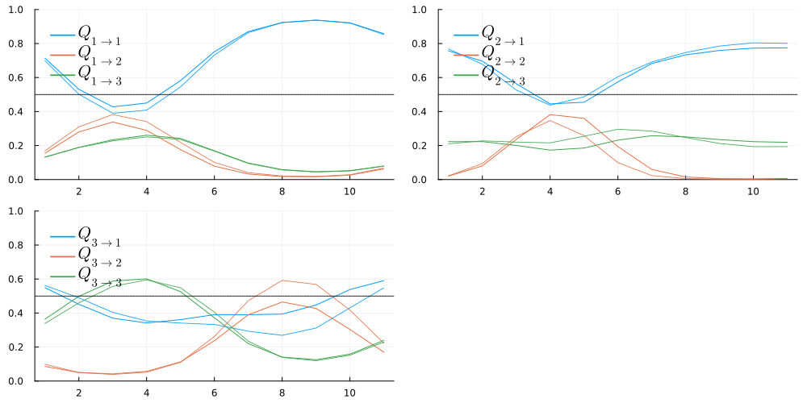
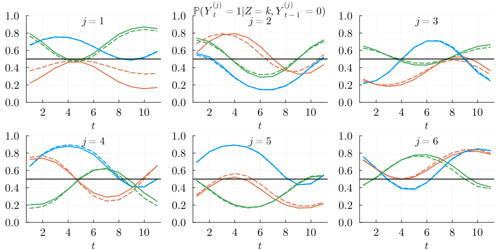
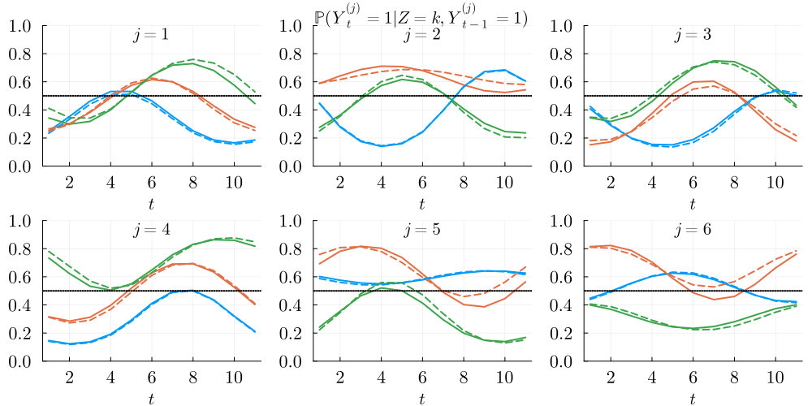

# SmoothPeriodicStatsModels

[](https://github.com/dmetivie/SmoothPeriodicStatsModels.jl/actions/workflows/CI.yml?query=branch%3Amaster)

This package is primarily built to be an extension of the [StochasticWeatherGenerators](https://github.com/dmetivie/StochasticWeatherGenerators.jl) package. See the [tutorial](https://dmetivie.github.io/StochasticWeatherGenerators.jl/dev/examples/tuto_paper/) for an example of usage.

It builds several smooth versions of statistical models for time series, currently including:

- AR(1) Auto-Regressive model of order 1
- Mixture Models
- Auto-Regressive Periodic Hidden Markov Model. For now, it only has Bernoulli mixture emission distributions, i.e., conditionally independent distributions.

**Smooth** means that temporal coefficients of the models e.g., $p(t)\in [0,1]$ for Bernoulli parameter and $t\in [1,T]$ have a periodic functional form to enforce smoothness i.e., $p(t)\simeq p(t+1)$.
Note that the package [PeriodicHiddenMarkovModels.jl](https://github.com/dmetivie/PeriodicHiddenMarkovModels.jl) also deals with Periodic HMM, but right now, it does not enforce smoothness; hence if you don't have many observations, you can have $p(t)$ very different from $p(t+1)$. Moreover, this causes identifiability issues of the hidden states.

The HMM part of this package could be moved at some point to [PeriodicHiddenMarkovModels.jl](https://github.com/dmetivie/PeriodicHiddenMarkovModels.jl), making use under the hood of the very nice and flexible [HiddenMarkovModels.jl](https://github.com/gdalle/HiddenMarkovModels.jl) package.

This is inspired by seasonal Hidden Markov Models; see [A. Touron (2019)](https://link.springer.com/article/10.1007/s11222-019-09854-4) and used in the paper [Interpretable Seasonal Multisite Hidden Markov Model for stochastic rain generation in France](https://hal.inrae.fr/hal-04621349).

## Example

This example shows how to use the `ARPeriodicHMM` model, which is a periodic HMM with multivariate Bernoulli emission distributions of dimension $D=6$ and autoregressive dependence on past observations. This model assumes conditional independence, i.e., given the hidden states and the past observations, the multivariate Bernoulli distribution is independent (conditional independence),

```math
\mathbb{P}(Y_n = y_t \mid Z_n = k, Y_{n-1} = y_{n-1}) = \prod_{j=1}^D \mathbb{P}\left(Y_{n}^{(j)} = y_{n}^{(j)}\mid  Z_n = k, Y_{n-1}^{(j)} = y_{n-1}^{(j)}\right).
```

Under the hood, to deal with arbitrary autoregressive orders, the past observations are encoded in a variable $H$ of dimension $D \times (2^p)$, where $p$ is the autoregressive order (see the [paper](https://hal.inrae.fr/hal-04621349) for a more precise definition).

### Set up

```julia
using SmoothPeriodicStatsModels
using Random
```

```julia
Random.seed!(2020)
K = 3 # Number of hidden states
T = 11 # Period
N = 49_586 # Length of observation
D = 6 # Dimension of observed variables
autoregressive_order = 1

size_order = 2^autoregressive_order
degree_of_P = 1
size_degree_of_P = 2*degree_of_P + 1 

trans_θ = 4*(rand(K, K - 1, size_degree_of_P) .- 1/2)
Bernoulli_θ = 2*(rand(K, D, size_order, size_degree_of_P) .- 1/2)
hmm = Trig2ARPeriodicHMM([1/3, 1/6, 1/2], trans_θ, Bernoulli_θ, T)
```

### Simulations

Multivariate observations are `dimension × sample`, the convention of `Distributions.jl`: `y[j, n]`
is site `j` at time `n`, and the initial condition `y_past[j, m]` is site `j` at `m` steps before
the first observation. The same holds for `Y`, `Y_past` and `lag_cat` everywhere in the package.

```julia
z_ini = 1
y_past = rand(Bool, D, autoregressive_order)
n2t = SmoothPeriodicStatsModels.n_to_t(N,T)
z, y = rand(hmm, n2t; y_ini=y_past, z_ini=z_ini, seq=true)
```

### Fit

Fitting lives in a package extension, so the solver stack has to be loaded. Any
[Optimization.jl](https://docs.sciml.ai/Optimization/stable/) algorithm will then do; this picks
`LBFGS` from `OptimizationOptimJL`, which is also the default.

```julia
using Optimization, OptimizationOptimJL, SimpleNonlinearSolve, ForwardDiff

trans_θ_guess = rand(K, K-1, size_degree_of_P)
Bernoulli_θ_guess = zeros(K, D, size_order, size_degree_of_P)
trans_θ_guess[:,:,1] .= trans_θ[:,:,1] # cheating on initial guess to recover very good MLE maxima
Bernoulli_θ_guess[:,:,:,1] = Bernoulli_θ[:,:,:,1]
hmm_guess = Trig2ARPeriodicHMM([1/4, 1/4, 1/2], trans_θ_guess, Bernoulli_θ_guess, T)

@time "FitMLE SHMM (Baum Welch)" hmm_fit, θq_fit, θy_fit, hist, histo_A, histo_B = fit_mle(hmm_guess, trans_θ_guess, Bernoulli_θ_guess, y, y_past, maxiter=10000, robust=true; display=:iter, tol=1e-3, θ_iters=true, n2t=n2t);
# EM converged in 317 iterations, logtot = -194299.41771034154
# FitMLE SHMM (Baum Welch): 8.808367 seconds (7.63 M allocations: 798.943 MiB, 3.00% gc time)
```

Every `fit_mle` takes the solver as a keyword, so any algorithm of the
[Optimization.jl](https://docs.sciml.ai/Optimization/stable/) ecosystem can be used, and the
independent sub-problems of each M-step can be run in parallel:

```julia
using OptimizationOptimJL
fit_mle(hmm_guess, trans_θ_guess, Bernoulli_θ_guess, y, y_past; n2t=n2t,
        solver = LBFGS(),                    # any Optimization.jl solver; this is the default
        ensemble = EnsembleThreads(),        # EnsembleSerial (default) / EnsembleThreads / EnsembleDistributed
        solve_kwargs = (maxiters = 100,))    # forwarded verbatim to `solve`
```

### The periodic AR(1): explicit parameters

Every model here is the same construction — a basis expansion pushed through a link that keeps a
parameter in its domain. As of v4 that construction has a name, in
[TimeVaryingParameters.jl](https://github.com/dmetivie/TimeVaryingParameters.jl): a `ParamSpec`,
one basis and one link per named parameter. The AR(1)

```math
y_n = \mu(t) + \rho(t) y_{n-1} + \sigma(t)\varepsilon_n, \qquad t = \texttt{n2t}[n]
```

is `ar1_spec(d, T)`, which is exactly

```julia
ParamSpec(
    μ = TrigBasis(T, d) => IdentityLink(),      # free
    ρ = TrigBasis(T, d) => IntervalLink(-1, 1), # stationary
    σ = TrigBasis(T, d) => LogLink(),           # positive
)
```

`TrigBasis(T, d)` is the `2d+1` column design `[1, cos, sin, cos 2, sin 2, …]` this package has
always used, so coefficients fitted under v3 keep their meaning.

A model is that **structure** together with its **parameters**, held apart the way `Lux.jl` holds
a layer apart from its weights:

```julia
m  = SmoothAR1(d, T)       # structure: bases, links, the period
ps = parameters(m)         # ComponentArray(μ = …, ρ = …, σ = …)
```

`ps` is named *and* a plain `AbstractVector`, so the same object reads as `ps.ρ` to you and goes
straight into an `OptimizationProblem` or through `ForwardDiff` with nothing flattened. That is
what replaces passing `θᴬ`, `θᴮ`, `θ_α`, `θ_Y` loose beside the model.

### Fitting: model in, model out

```julia
m, history = fit_mle(m, y; n2t)
```

Two values, always, for every model in the package. This is the convention of every
sequence-model package in the Julia ecosystem — `HiddenMarkovModels.baum_welch`,
`HMMBase.fit_mle`, `PeriodicHiddenMarkovModels.fit_mle`,
[`ExpectationMaximization.fit_mle`](https://github.com/dmetivie/ExpectationMaximization.jl) — and
it works because the coefficients travel *inside* the model, so nothing has to come back beside
it.

```julia
parameters(m).ρ      # that parameter's 2d+1 coefficients, by name
curve(m, :σ)         # σ(t) for t = 1:T, links already applied
m(196)               # (μ, ρ, σ) at one time
nparams(m)           # the number of free coefficients

AR1(m)               # the evaluated twin: three curves, ready to simulate from
rand(m, 10_000)      # ... or simulate from the model directly

history.converged
history.retcode      # what the solver reported
history.objective    # the attained negative loglikelihood
history.stats        # iterations, function evaluations, time

loglikelihood(m, y; n2t)   # normalising constant included, so it is comparable
```

Pass `spec` to fit a parametrization other than the trigonometric one — a trend beside the
seasonal cycle, a different degree per parameter, monthly indicators:

```julia
spec = ParamSpec(
    μ = ConstantBasis() + PolynomialBasis(1; center = T/2, scale = T) + FourierBasis(T, 1) => IdentityLink(),
    ρ = TrigBasis(T, 1) => IntervalLink(-1, 1),
    σ = TrigBasis(T, 2) => LogLink(),
)
m, history = fit_mle(SmoothAR1(spec, T), y; n2t)
```

`σ`'s link has to stay `LogLink()` — that is the one thing `ar1_nll` assumes, since it reads σ on
the log scale rather than exponentiating and taking the log back.

`fit_mle(m, y, z; n2t)` fits one AR(1) per hidden state in an `EnsembleProblem`. Build the model
with `SmoothAR1(d, T; K)` and `parameters(m).ρ` is `(2d+1) × K`, `curve(m, :ρ)` is `K × T` — the
layout `AR1` indexes as `ρ[k, t]` — and `history.retcode` is one code per state. Without `K`
every state simply starts from the same column.

### Choosing between fits

`fit_mle` deliberately does not remember the data, so it cannot answer `aic` or `bic`.
`fit(SeasonalFit, …)` is the second tier, borrowed from
[Copulas.jl](https://github.com/lrnv/Copulas.jl): the same estimator, with the inference metadata
kept.

```julia
f = fit(SeasonalFit, SmoothAR1(d, T), y; n2t)

f.model, f.history   # exactly what `fit_mle` would have returned
coef(f, :ρ)          # and the usual accessors
curve(f, :σ)
rand(f, 10_000)

loglikelihood(f), dof(f), nobs(f)
aic(f), bic(f)       # free: `SeasonalFit` is a `StatsAPI.StatisticalModel`
```

`bic` is what to reach for when choosing a degree or a number of states; it replaces assembling
`bic_sel(LL, K, memory, d, D, penality)` by hand. Note `nobs` counts *transitions*, not
observations: the AR(1) likelihood is conditional on the first point, which contributes no term.

> **Migrating from v3.** `fit_mle_AR1(y, d, T)` returned `(θμ, θρ, θσ)`. The replacement is
> `fit_mle(SmoothAR1(d, T), y; n2t)`, returning `(model, history)`, with the three coefficient
> blocks at `parameters(model).μ`, `.ρ` and `.σ`. The coefficients themselves are unchanged, so
> `parameters(model).μ == θμ` up to the fit.

### The seasonal mixture

A mixture whose weights *and* component parameters are smooth functions of the period index is
the same `(structure, parameters)` pair as the AR(1), fitted by the same call:

```julia
m  = SmoothSeasonalMixture(Exponential, 2, 1, 366; init = [1.0, 5.0])  # K = 2, degree 1
ps = parameters(m)         # ComponentArray(α = …, Y = …)
ps.α                       # (2dα+1) × (K-1), the free categories' coefficients
component_coefs(m, 2)      # component 2's own coefficients, a writable view into ps.Y

m, history = fit_mle(m, y; n2t)

m(196)                     # the `MixtureModel` at one period index
mixtures(m)                # all T of them — the evaluated twin, to simulate from
curve(m, :θ)               # K × T, each component's scale over the period
mixture_weights(m)         # K × T, the mixing weights
loglikelihood(m, y; n2t)
```

`init` gives each component its starting parameter — a number, a coefficient vector, or a
`NamedTuple` for a family with several parameters — and the `K` entries must differ: identical
components give identical posteriors, and EM cannot move off that point.

**The components need not match.** Each one carries its own family *and* its own basis, so a
mixture of two different laws, or of one seasonal law and one constant one, is a list of
`distribution => degree` pairs:

```julia
m = SmoothSeasonalMixture([Exponential => 0, Gamma => 2], 366;
                          init = [2.0, (α = 3.0, θ = 1.0)])

component_coefs(m, 1)      # 1 coefficient  — degree 0, so no season
component_coefs(m, 2)      # 10 coefficients — shape and scale, each at degree 2
curve(m, :θ)               # 2 × T: both have a θ, read through their own bases
```

Because components may take different numbers of coefficients, `parameters(m).Y` holds them end
to end rather than one per column, and `component_coefs(m, k)` is the way in. It is a view, so
writing through it sets the model's coefficients. (`SmoothAR1`'s per-state blocks *are* a matrix
— there every state shares one spec by construction, which a mixture's components need not.)

The mixing weights are `mixture_weights(m)` and not `curve(m, :α)`, deliberately: `α` is this
package's name for a weight and also `Gamma`'s name for its shape, and a `curve` that answered
with the weights would silently shadow the shape of a `Gamma` mixture.

The EM loop itself is
[ExpectationMaximization.jl](https://github.com/dmetivie/ExpectationMaximization.jl)'s. Only the
*parametrization* here is periodic, so this package supplies that — `SeasonalWeights`,
`SeasonalFamily` and `SeasonalSample` carry it, and the `loglikelihoods!` and `M_step!` methods
they dispatch are the seasonal E- and M-steps. Nothing in that package needed changing, and a
consequence worth knowing is that its keywords work here too: `rtol` alongside `tol`,
`method = StochasticEM(rng)`, and a vector of per-observation weights passed positionally after
`y`.

### Adding your own seasonal family

The seasonal mixture is not tied to `Exponential`. A family is used as a component as soon as
this package knows **how its parameters vary with the period index** — one basis and one link
each, in the order the constructor takes them. That is one line:

```julia
using SmoothPeriodicStatsModels, Distributions
const SPSM = SmoothPeriodicStatsModels

SPSM.seasonal_family(::Type{Pareto}, basis) =
    TimeVaryingFamily(Pareto, ParamSpec(α = basis => LogLink(), θ = basis => LogLink()))
```

`Exponential`, `Rayleigh`, `Gamma`, `Weibull`, `Normal` and `LogNormal` are declared already, so
those need nothing at all:

```julia
using Optimization, OptimizationOptimJL, SimpleNonlinearSolve, ForwardDiff

T, N = 20, 4000
n2t = repeat(1:T, N ÷ T)
theta_true = hcat([0.3, 0.4, -0.2], [1.6, -0.3, 0.5], [0.1, -0.5, 1.0])
mix(t, th) = MixtureModel([Rayleigh(exp(polynomial_trigo(t, th[:, 1]))),
                           Rayleigh(exp(polynomial_trigo(t, th[:, 2])))],
                          [αₜ(t, th[:, 3]), 1 - αₜ(t, th[:, 3])])
y = [rand(mix(t / T, theta_true)) for t in n2t]

m, history = fit_mle(SmoothSeasonalMixture(Rayleigh, 2, 1, T; init = [1.0, exp(1.0)]), y; n2t)

# A typical run (the draws above are unseeded, so the digits move a little):
# history           converged in 101 iterations, loglikelihood -8165.31
# parameters(m).Y   [0.338 1.588; 0.435 -0.288; -0.235 0.495]
#                   (true [0.3, 0.4, -0.2] and [1.6, -0.3, 0.5])
```

The generic M-step maximizes the weighted loglikelihood of the family directly: one matrix-vector
product per parameter and `T` distribution constructions per iteration, not `N` of them. A family
with several seasonal parameters — `Gamma`'s shape *and* scale — costs nothing extra to state.

#### When you want the sufficient-statistic speedup

Some families collapse onto per-period sufficient statistics, and the observations then stop
being touched inside the solver loop at all. That is worth writing by hand, and it is a method of
`update_dist`, dispatched on the family. Here is the seasonal `Rayleigh` of above in that form —
measured against the generic route, the `Exponential` equivalent runs its EM about 3.5× faster:

```julia
# logpdf = log(y) - 2log(S) - y^2 / (2S^2), weighted by the posteriors and summed per period
function rayleigh_nll(theta, (s_pi, s_piy2, basis))
    P = basis * theta
    nll = zero(eltype(P))
    for t in eachindex(P)
        nll += 2 * s_pi[t] * P[t] + s_piy2[t] * exp(-2P[t]) / 2
    end
    return nll
end

function SPSM.update_dist(fam::TimeVaryingFamily{SPSM.DistConstructor{Rayleigh}},
        design::PeriodicDesign, theta, gamma, obs, n_in_t;
        solver = default_solver(), adtype = default_adtype(), solve_kwargs = (;))
    T, total = design.nT, sum(gamma)
    s_pi   = [sum(gamma[n]            for n in n_in_t[t]; init = 0.0) / total for t = 1:T]
    s_piy2 = [sum(gamma[n] * obs[n]^2 for n in n_in_t[t]; init = 0.0) / total for t = 1:T]

    theta = solve_unconstrained(rayleigh_nll, collect(float.(theta)),
        (s_pi, s_piy2, design.designs[1]); solver, adtype, solve_kwargs)

    return distributions(fam, design, theta), theta
end
```

Dividing by the total posterior weight is not cosmetic: it leaves the argmin alone and keeps the
gradient independent of `N`, which is what stops the first `LBFGS` step from throwing the link
into underflow. The methods in this package do the same.

Nothing else changes: `fit_mle` is the same call, and the two routes reach the same estimator —
the test suite asserts they agree to 1e-9 in the coefficients and take the same number of EM
iterations.

Note that the emission of `ARPeriodicHMM` is *not yet* pluggable this way: the binary memory encoding
(`conditional_to`, `bin2digit`, the `2^order` axis of `B`) makes the Bernoulli family structural
there rather than a choice.

### Plots

<details close>

<summary>Code for the plot</summary>

```julia
using LaTeXStrings, Plots
using Distributions: succprob

default(fontfamily="Computer Modern", linewidth=2, label=nothing, grid=true, framestyle=:default, legendfontsize=14, foreground_color_legend=nothing, background_color_legend=nothing, tickfontsize=14, xlabelfontsize=14, ylabelfontsize=14)
```

```julia
begin
    pA = [plot() for k in 1:K]
    for k in 1:K
        [plot!(pA[k], hmm.A[k, l, :], c=l, label=L"Q_{%$(k)\to %$(l)}", legend=:topleft) for l in 1:K]
        [plot!(pA[k], hmm_fit.A[k, l, :], c=l, label=:none, legend=:topleft, s = :dash) for l in 1:K]

        hline!(pA[k], [0.5], c=:black, label=:none, s=:dot)
        ylims!(0,1)
        xlabel!(pA[k], L"t")
    end
    pallA = plot(pA..., size=(1000, 500), bottom_margin=3Plots.mm)
end
```

```julia
begin
    mm = 1 # H = 1  <=> {Y_{t-1} = 0}
    pB = [plot() for j in 1:D]
    for j in 1:D
        [plot!(pB[j], succprob.(hmm.B[k, :, j, mm]), c=k, label=:none) for k in 1:K]
        [plot!(pB[j], succprob.(hmm_fit.B[k, :, j, mm]), c=k, label=:none, s = :dash) for k in 1:K]

        hline!(pB[j], [0.5], c=:black, label=:none, s=:dot)
        ylims!(pB[j], (0, 1))
        xlabel!(pB[j], L"t")
        annotate!(pB[j], (0.5, 0.93), L"j=%$(j)")
        j==2 ? title!(pB[j], L"\mathbb{P}(Y_t^{(j)}=1|Z=k, Y_{t-1}^{(j)} = 0)") : nothing
    end
    pallB = plot(pB..., size=(1000, 500), bottom_margin=3Plots.mm)
end

begin
    mm = 2 # H = 2 <=> {Y_{t-1} = 1}
    pB = [plot() for j in 1:D]
    for j in 1:D
        [plot!(pB[j], succprob.(hmm.B[k, :, j, mm]), c=k, label=:none) for k in 1:K]
        [plot!(pB[j], succprob.(hmm_fit.B[k, :, j, mm]), c=k, label=:none, s = :dash) for k in 1:K]

        hline!(pB[j], [0.5], c=:black, label=:none, s=:dot)
        ylims!(pB[j], (0, 1))
        xlabel!(pB[j], L"t")
        j==2 ? title!(pB[j], L"\mathbb{P}(Y_t^{(j)}=1|Z=k, Y_{t-1}^{(j)} = 1)") : nothing
        annotate!(pB[j], (0.5, 0.93), L"j=%$(j)")
    end
    pallB = plot(pB..., size=(1000, 500), bottom_margin=3Plots.mm)
end
```

</details>

**Transition matrix:**


**Emission distributions:**


